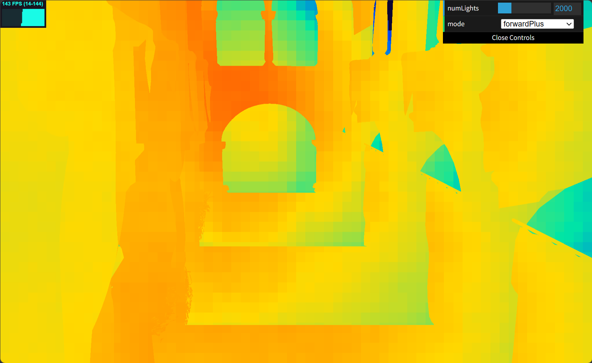
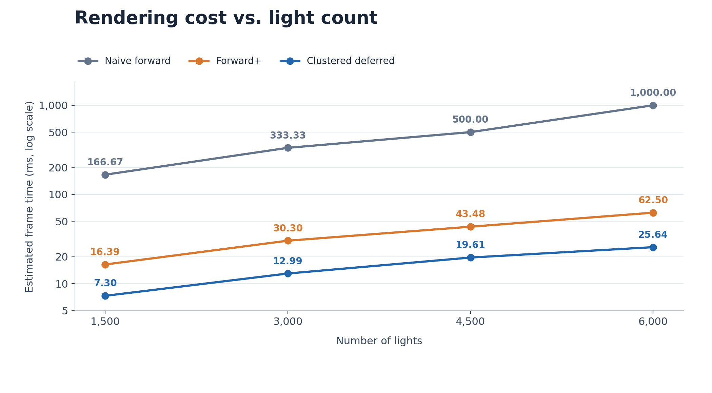
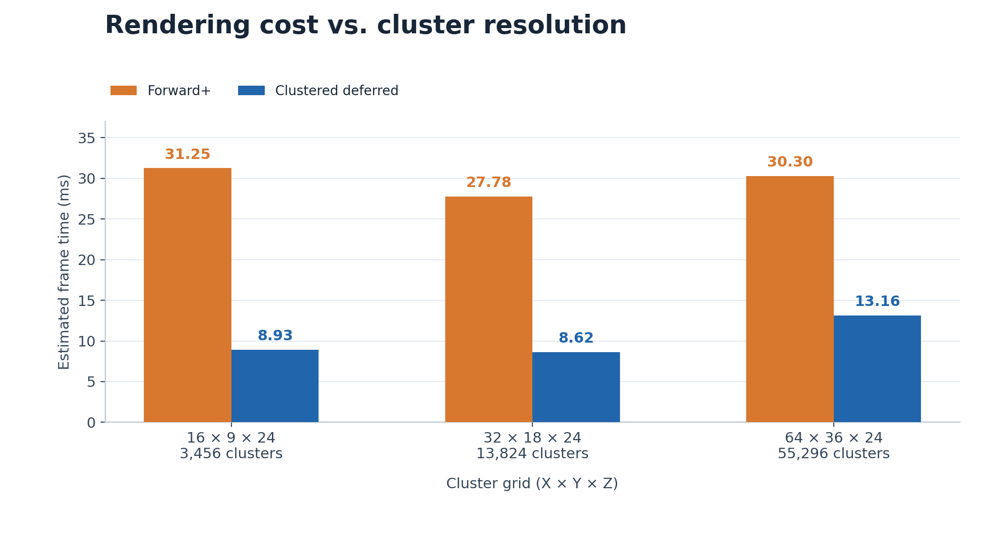

# WebGPU Forward+ and Clustered Deferred Shading

**Zi Yang** · [LinkedIn](https://www.linkedin.com/in/zi-yang-3359653b2/)  
University of Pennsylvania · CIS 5650 · Project 4

A WebGPU project comparing naive forward, Forward+, and clustered deferred rendering under different light counts and cluster resolutions.

**Live Demo:** https://guoren0830.github.io/Project4-WebGPU-Forward-Plus-and-Clustered-Deferred/

<!-- Confirm that showcase.gif is at least 30 seconds and demonstrates every implemented feature. Add a separate running screenshot; a heatmap is useful too. -->

<!-- Source review pending. Add only verified implementation details and extra-credit features here. -->

## Test Environment

Windows 11 · AMD Ryzen 9 7845HX · 16 GB RAM  
NVIDIA GeForce RTX 4060 Laptop GPU · 8 GB VRAM

## Performance Analysis

Times below are estimated as **1000 / reported FPS**, using the supplied integer-FPS readings.

### Number of Lights

Clustered deferred was about **2.2–2.4× faster than Forward+** in my tests. At 6,000 lights, it took **25.64 ms**, compared with **62.50 ms** for Forward+. Both were much faster than naive rendering because clustering reduces the number of lights checked during shading.

Deferred shading may save more lighting work when geometry overlaps, but requires extra G-buffer memory and bandwidth. Forward+ is easier to use with transparency and MSAA. Clustering helps less when many lights overlap the same clusters.

### Cluster Resolution

The **32 × 18 × 24** grid was fastest: **27.78 ms** for Forward+ and **8.62 ms** for clustered deferred. Finer grids can reduce the lights per cluster, but add clustering and storage costs. The **64 × 36 × 24** grid was slower in both renderers, suggesting that the extra overhead outweighed the benefit.
